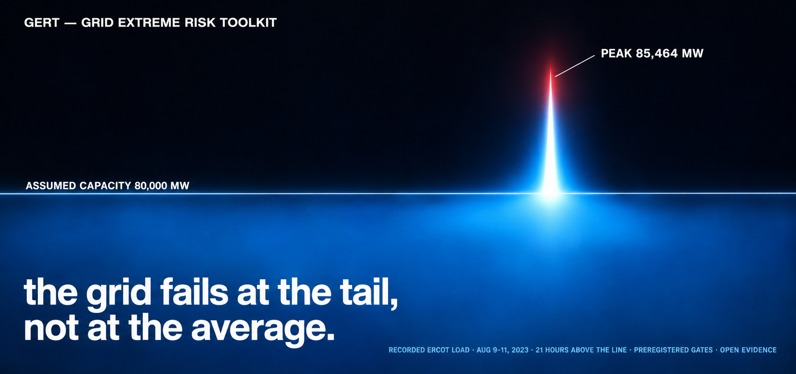
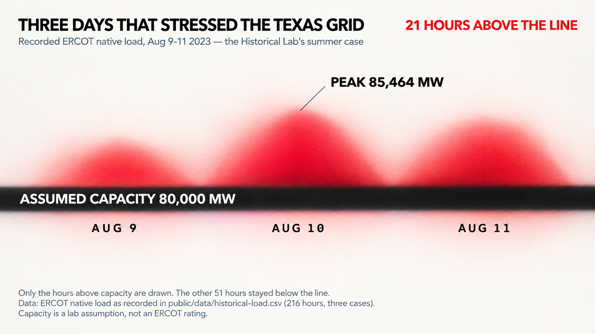
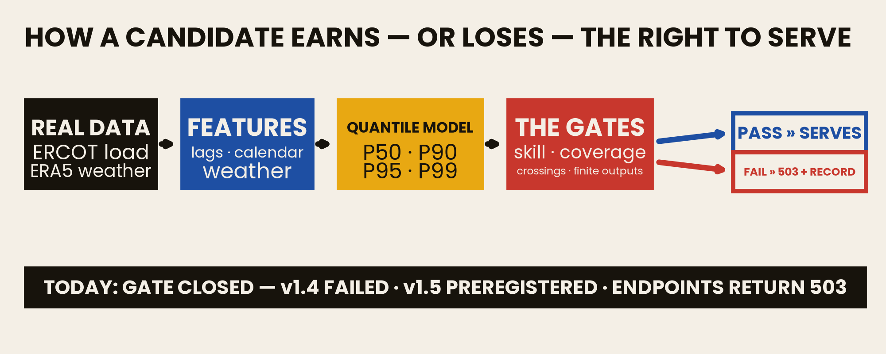
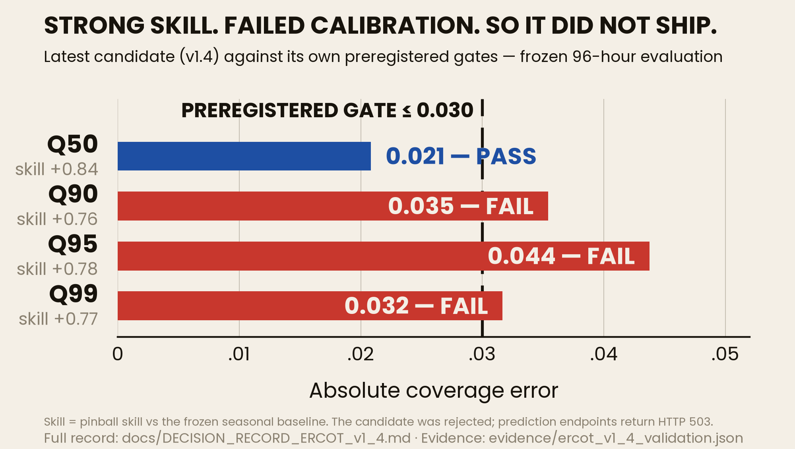
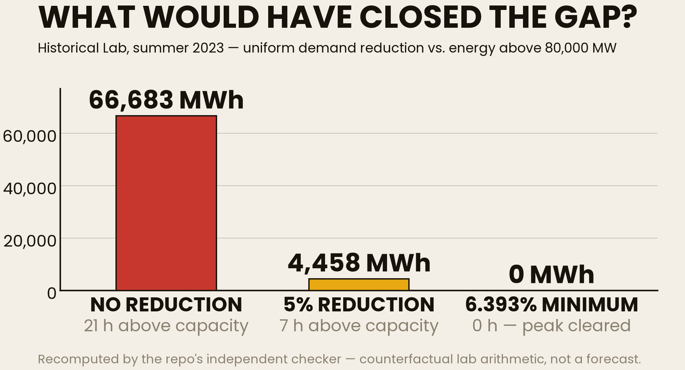
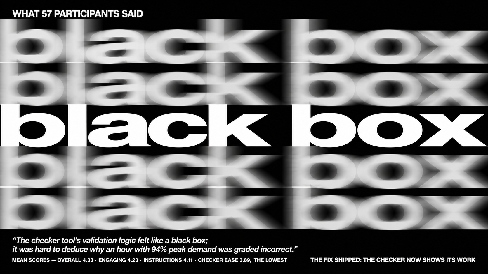
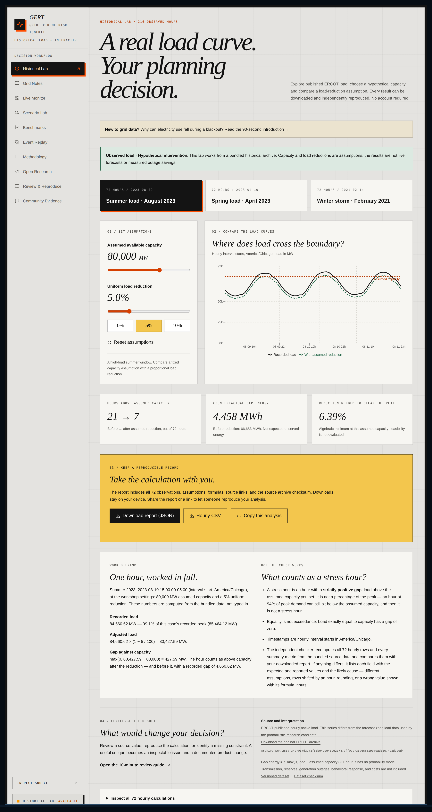
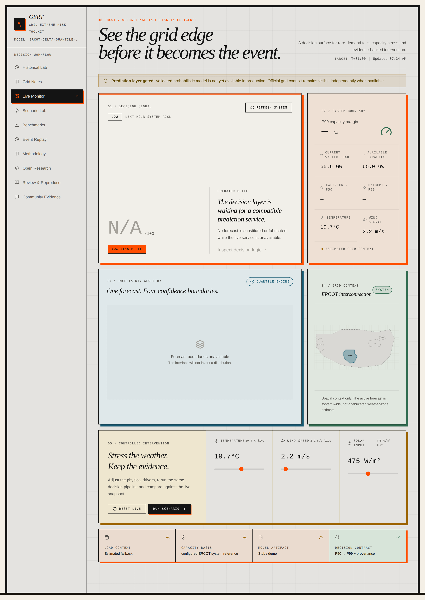
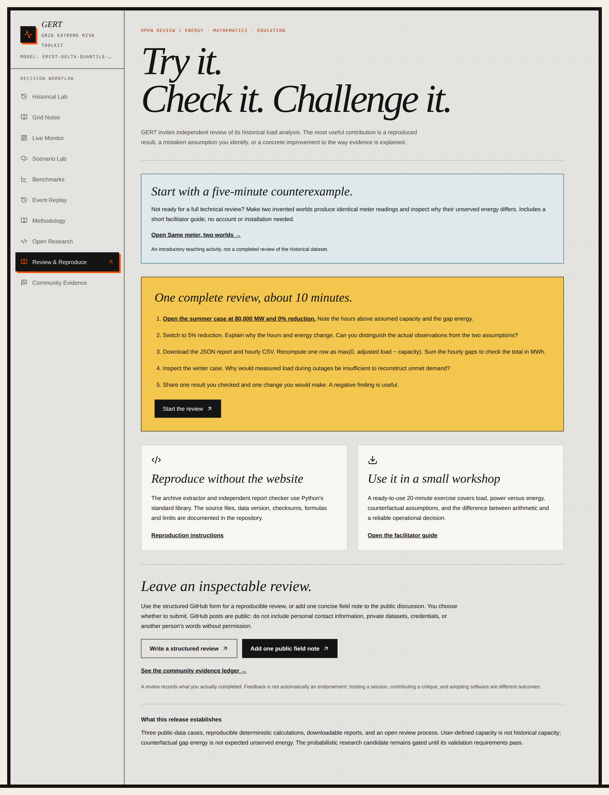

[](https://github.com/DresdenGman/Grid-Extreme-Risk-Toolkit-GERT-/actions/workflows/ci.yml)
[](LICENSE)
[](https://doi.org/10.5281/zenodo.23982226)
[](https://doi.org/10.5281/zenodo.22975251)
[](https://gert-d.vercel.app)

**Probabilistic grid-risk decision support with tail-risk analysis, calibration gates, and explicit data/model provenance.**

| 216 | 115+ participants | Skill is not enough | Archived |
| --- | --- | --- | --- |
| recorded ERCOT hours in the public Historical Lab — every number on this page can be recomputed from them | ran the lab in two pilot sessions; **57** returned the survey, and their criticism is printed below, not buried | the latest model candidate scored pinball skill **+0.76 to +0.84** — and was **rejected** for missing its calibration gates | software and dataset carry separate Zenodo DOIs (badges above); releases are versioned and citable |

## Start here

| If you want to… | Go here | Time |
| --- | --- | --- |
| Reproduce the Historical Lab calculations yourself | [Colab reproduction notebook](docs/notebooks/README.md) or [reproduction guide](docs/HISTORICAL_LAB.md) | ~15 min |
| Review the evidence, including why the latest model candidate was rejected | [Evidence page](https://gert-d.vercel.app/review) and the [v1.4 decision record](docs/DECISION_RECORD_ERCOT_v1_4.md) | ~10 min |
| Run GERT with a class or group | [20-minute workshop plan](docs/WORKSHOP.md) | 20 min |

## The problem, in one picture



In August 2023, Texas electricity demand crossed an 80,000 MW line 21 times in three days. A grid does not fail at the average — it fails at the tail. GERT exists to make that tail visible early: how close an unlikely-but-plausible demand peak comes to the system boundary, what would have to change to stay clear of it, and — just as visibly — when its own forecasting model is not good enough to be trusted with the answer.

## How a candidate earns the right to serve



Every model candidate is judged against gates that are written down **before** its evaluation window is opened — and the verdict is published either way.



**Latest probabilistic candidate (`ercot-delta-quantile-v1.4`) — rejected for production, by its own predeclared gates** (frozen 96-hour evaluation window; machine-readable evidence in [`evidence/ercot_v1_4_validation.json`](evidence/ercot_v1_4_validation.json), full record in [`docs/DECISION_RECORD_ERCOT_v1_4.md`](docs/DECISION_RECORD_ERCOT_v1_4.md)):

| Gate | Requirement | Observed | Result |
| --- | --- | --- | --- |
| Pinball skill vs frozen seasonal baseline | > 0 at every quantile | +0.76 to +0.84 | Pass |
| Q50 calibration error | ≤ 0.03 | 0.021 | Pass |
| Q90 calibration error | ≤ 0.03 | 0.035 | **Fail** |
| Q95 calibration error | ≤ 0.03 | 0.044 | **Fail** |
| Q99 calibration error | ≤ 0.03 | 0.032 | **Fail** |
| Quantile crossings | 0 | 0 | Pass |

Ninety-six hourly observations is a small sample for tail quantiles — the [tail sample diagnostic](docs/TAIL_SAMPLE_DIAGNOSTIC.md) documents what this window can and cannot resolve. The gates were applied exactly as predeclared: the thresholds were fixed before the evaluation window was opened and were not relaxed after the failure. Until a candidate passes every gate, the prediction, scenario, and validated-backtest endpoints return an explicit `503`.

A later candidate, `ercot-lag-residual-gbt-v1.5-candidate`, is evidence only. It is not packaged, and those endpoints stay gated. See the [v1.5 decision record](docs/DECISION_RECORD_ERCOT_v1_5.md). The v1.4 rejection stands. The v1.5 preregistration was committed after its evaluation window closed; it is not a prospective freeze.

## Historical Lab — the part anyone can run today



**Historical Lab (public, no credentials needed)** — 216 observed hourly ERCOT native-load values across three 72-hour windows (Aug 9–11 2023, Apr 10–12 2023, Feb 14–16 2021). Reference check for one case (`summer-2023`, 72 h, assumed capacity 80,000 MW), recomputed with the repo's independent Python checker (`scripts/verify_historical_report.py`):

| Setting | Hours above capacity | Gap energy | Minimum uniform reduction to clear the peak |
| --- | --- | --- | --- |
| 0% reduction | 21 | 66,683 MWh | 6.393% |
| 5% reduction | 7 | 4,458 MWh | 6.393% |

The minimum uniform reduction is a property of the recorded peak (85,464 MW) against the assumed capacity, so it is identical in both rows by definition.

[Open the working lab](https://gert-d.vercel.app/history) ·
[Review it in 10 minutes](https://gert-d.vercel.app/review) ·
[Reproduce the calculations](docs/HISTORICAL_LAB.md) ·
[Run a 20-minute workshop](docs/WORKSHOP.md) ·
[Pilot feedback — 57 responses](docs/FEEDBACK.md)

Select a case, set an assumed capacity and a uniform load reduction, compare outcomes, then export the hourly CSV and a JSON report with sources, assumptions, and checksums. This is deterministic historical analysis: capacity and interventions are counterfactual assumptions, and the calculated gap energy is not a probabilistic forecast, expected unserved energy, or realized savings. Reviewers can use the Historical Lab without credentials or a model server.

## What participants said



> "The checker tool's validation logic felt like a black box; it was hard to deduce why an hour with 94% peak demand was graded incorrect."
> — pilot participant, quoted with consent ([full feedback report](docs/FEEDBACK.md))

That criticism was acted on in the open: the checker now explains every rejection field by field — expected value, submitted value, difference, and the likely cause — and the lab page works a real example end to end before asking anyone to trust it.

## See it

The Historical Lab, running on the bundled 216-hour dataset — assumptions on the left, the crossing chart and the three headline numbers on the right, then a worked example that shows every step of one hour's arithmetic:



<table>
<tr>
<td width="50%"></td>
<td width="50%"></td>
</tr>
<tr>
<td><b>Live Monitor.</b> The gate is visible in the product itself: the candidate is labeled REJECTED, the signal reads AWAITING MODEL, and no forecast is substituted or fabricated while the service is unavailable.</td>
<td><b>Review &amp; Reproduce.</b> The standing invitation: a five-minute counterexample, a guided 10-minute review, and full reproduction without the website.</td>
</tr>
</table>

## Public product state

- **Official operating context:** the backend can retrieve current ERCOT load and adequacy data with server-side ERCOT credentials.
- **Weather context:** live weather is retrieved from external public sources with timestamps and provenance.
- **Probabilistic model:** the latest `ercot-delta-quantile-v1.4` candidate is **rejected for production**. It demonstrated positive pinball skill at every reported quantile, but missed the predeclared ±3 percentage-point calibration tolerance at Q90, Q95, and Q99 on the frozen 96-hour evaluation window.
- **Production behavior:** prediction, scenario, and validated-backtest endpoints return an explicit `503` until a `validated_production` artifact is active.
- **Evidence:** sanitized candidate results remain public through `GET /model/evidence` and the Evidence page.
- **Presentation mode:** `?demo=1` is an explicit simulated mode for interface demonstrations. Live mode never falls back to simulated predictions after an error.

> GERT is research and decision-support software, not autonomous grid control. Unvalidated, simulated, fallback, and unavailable states are labeled and never silently promoted to production authority.

The release contract and promotion gates are documented in [`docs/PRODUCT_RELEASE_ACCEPTANCE.md`](docs/PRODUCT_RELEASE_ACCEPTANCE.md).

## Product surfaces

| Surface | Purpose | Authority |
| --- | --- | --- |
| Live Monitor | Official load, capacity context, weather, timestamps, and provenance | Operational context |
| Scenario Lab | Perturb weather and physical drivers through the active model contract | Gated until model validation |
| Event Replay | Explain how tail pressure can evolve during an extreme event | Labeled educational reconstruction |
| Evidence | Publish skill, coverage, promotion gates, provenance, and limitations | Versioned observed evidence |


## Mathematical core

GERT models a conditional distribution rather than only a conditional mean. For quantile level `q`, training minimizes pinball loss:

```text
Lq(y, y_hat) = max(q(y - y_hat), (q - 1)(y - y_hat))
```

The current research path predicts one-hour load change relative to the latest official load anchor and reconstructs ordered P50/P90/P95/P99 levels. Promotion requires all frozen gates to pass:

1. Positive pinball skill against the frozen month-hour baseline at every served quantile.
2. Absolute empirical-coverage error no greater than `0.03` at P50/P90/P95/P99.
3. Quantile-crossing rate no greater than `0.05`.
4. Finite outputs and serving features available at prediction time.
5. An immutable metadata, evaluation, and evidence bundle.

A failed candidate remains research evidence; thresholds are not changed after the evaluation window is observed.

## Architecture

```text
ERCOT Public API ─┐
                  ├─ FastAPI evidence + data layer ── Next.js product UI
Weather sources ──┘               │
                                  ├─ artifact validation gate
                                  ├─ risk and scenario services
                                  └─ SQLite/PostgreSQL persistence
```

- **Frontend:** Next.js 16, React 18, TypeScript, Tailwind CSS, Recharts.
- **Backend:** FastAPI, Pydantic 2, SQLAlchemy 2, NumPy/SciPy/scikit-learn.
- **Public release:** Vercel Next.js frontend with same-origin `/api/gert` runtime. Historical analysis runs entirely in the browser. FastAPI/Railway remains a separate supported deployment path.
- **Security:** explicit production CORS, request IDs, rate limits, no-store API responses, browser security headers, non-root container, and server-only credentials.

## Local development

To run the public Historical Lab alone:

```bash
npm ci
npm run dev
```

No ERCOT credentials, Python environment, or running backend are required for
that workflow. The optional separate backend setup is below.

Requirements:

- Node.js 22+
- Python 3.12+

```bash
git clone https://github.com/DresdenGman/Grid-Extreme-Risk-Toolkit-GERT-.git
cd Grid-Extreme-Risk-Toolkit-GERT-

npm ci
python3 -m venv .venv
./.venv/bin/pip install -r requirements.txt -r requirements-training.txt

cp .env.example .env
```

Run the backend and frontend in separate terminals:

```bash
APP_ENV=development MODEL_BACKEND=stub ./.venv/bin/uvicorn api.app:app --reload --port 8000
NEXT_PUBLIC_API_URL=http://localhost:8000 NEXT_PUBLIC_DATA_MODE=live npm run dev
```

Open `http://localhost:3000`; API documentation is at `http://localhost:8000/docs`.

The stub is available for development, but production deliberately refuses stub predictions. To run a real artifact, set `MODEL_BACKEND=real` and `MODEL_ARTIFACT_DIR` to a validated artifact directory.

## Configuration

Backend secrets belong only in Railway or a local ignored environment file. Never expose them with a `NEXT_PUBLIC_` prefix.

| Variable | Purpose |
| --- | --- |
| `APP_ENV` | `development`, `test`, or `production` |
| `ALLOWED_ORIGINS` | Comma-separated exact frontend origins |
| `DATABASE_URL` | SQLite or PostgreSQL connection string |
| `MODEL_BACKEND` | `stub` or `real` |
| `MODEL_ARTIFACT_DIR` | Required for `MODEL_BACKEND=real` |
| `ERCOT_API_USERNAME` | ERCOT Public API credential, backend only |
| `ERCOT_API_PASSWORD` | ERCOT Public API credential, backend only |
| `ERCOT_API_SUBSCRIPTION_KEY` | ERCOT subscription key, backend only |
| `NEXT_PUBLIC_API_URL` | Public backend base URL compiled into the frontend |
| `NEXT_PUBLIC_DATA_MODE` | `live` for public use; `demo` only for explicit presentation builds |

See [`.env.example`](.env.example) for the full template.

## Verification

```bash
# Backend and model contracts
./.venv/bin/python -m pytest -q

# Frontend
npm run lint
npm run test:frontend
npm run build

# Dependency security
npm audit --audit-level=high
./.venv/bin/pip-audit -r requirements.txt --progress-spinner off

# Container
docker build -t gert-backend .
```

CI repeats the tests, typecheck, dependency audits, production build, container readiness, production stub gate, CORS checks, and security-header checks.

## API truth-state endpoints

- `GET /health` — process liveness and active backend label.
- `GET /ready` — database readiness.
- `GET /status` — public capability state without configuration or secrets.
- `GET /model/evidence` — versioned sanitized candidate evaluation.
- `GET /load/current?region=ERCOT_SYSTEM` — current operating context.
- `POST /predict` — probabilistic inference; gated in production without a validated artifact.

## License

MIT
